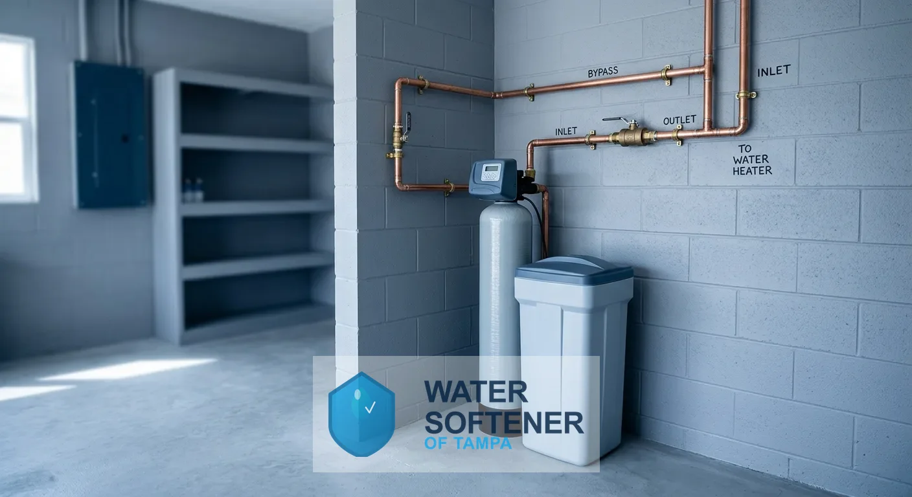

## How Does Water Softener Installation Work in Tampa, FL?

Every installation follows the same four steps, from the first call to the follow-up visit.

### Step 1: Free Estimate and Water Test

A technician tests your water for hardness and reviews your household size, your water use and the install location.

### Step 2: Custom System Recommendation

You receive a written recommendation with the system type, the grain capacity and an itemized price. At 12.3 gpg, a household of four using 320 gallons a day removes about 3,900 grains daily, so a 32,000-grain unit regenerates about every 8 days.

### Step 3: Professional Installation

A qualified technician installs the system, connects the drain and brine line, programs the control head and tests every tap. A standard install typically takes about 2 to 4 hours.

### Step 4: Ongoing Support and Maintenance

Salt refills, settings and a yearly inspection keep the system at capacity, and you can call with questions after the job is done.

## Frequently Asked Questions About Water Softeners in Tampa, FL

Most questions homeowners ask before buying fall into eight areas: water hardness, cost, system choice, timeline, water source, upkeep and where we work.

How hard is Tampa water?

Tampa water is very hard. The Tampa Water Department's 2025 water quality report put average total hardness at 12.3 grains per gallon, about 211 mg/L, and the City of Tampa says the figure runs between about 8 and 17 grains per gallon through the year. Hardness changes with the season, so a free test at your tap gives the number that matters for sizing.

How much does water softener installation cost in Tampa, FL?

Installed price depends on system capacity, system type, plumbing layout and whether a drain line already exists. The free estimate gives an itemized price for your home before any work begins.

What is the best water softener for Tampa water?

The best system matches your household size and your test results. A salt-based softener removes hardness minerals and suits Tampa's very hard water, and the technician sizes its capacity to your daily water use. Salt-free systems suit homeowners who prioritize low maintenance.

Salt vs. salt-free water softener: what is the difference?

A salt-based softener removes calcium and magnesium through ion exchange and needs salt refills and a drain. A salt-free system conditions the water so scale does not stick, adds no sodium, and leaves the minerals in the water. Salt-based units deliver true softening, while salt-free units reduce scale.

How long does water softener installation take?

Most installations finish in a single visit, typically in about 2 to 4 hours. The technician confirms the timeline at your estimate, based on plumbing access and system type.

Do I need a water softener with city water or well water in Tampa?

Both benefit. City water from the Tampa Water Department comes mainly from the Hillsborough River, and it still arrives hard. Private well water draws directly from an aquifer and can be harder and carry iron or other minerals. Nobody tests a private well for you, so a test shows whether a softener alone is enough.

How often does a water softener need maintenance?

Check the salt level monthly and refill when it drops below one-third full. Have a technician service the system once a year to inspect the resin bed, brine tank and valve.

What areas do you serve?

We serve Tampa and Hillsborough County, including Hyde Park, Seminole Heights, Ybor City and Davis Islands.

## Where Do You Install Water Softeners Around Tampa, FL?

Water Softener of Tampa provides water softener installation, replacement, repair and water testing across Tampa and Hillsborough County, including Hyde Park, Seminole Heights, Ybor City and Davis Islands. Whether your home uses Tampa Water Department city water or a private well, call or request a free estimate and we will confirm service to your address.
