

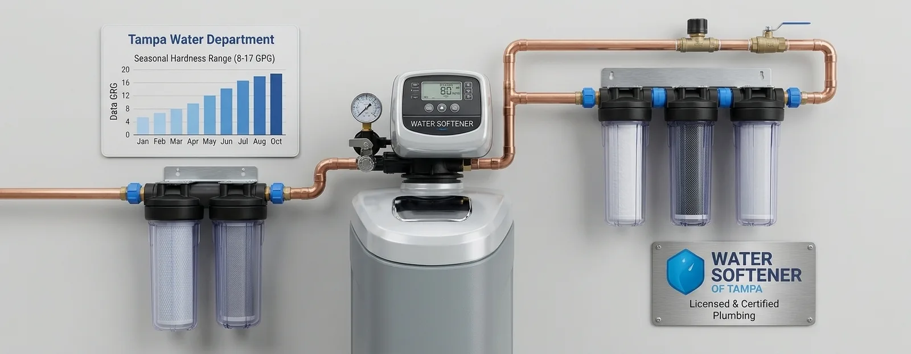

## Why Are We the Premier Water Softener Installation Company in Tampa, FL?

At **Water Softener of Tampa**, we recommend evaluating every water treatment contractor against six strict local benchmarks:

- Licensed FL CPC Plumbing
- WQA-Certified Technicians
- Floridan Aquifer Calibration
- Itemized GPM Sizing
- Multi-Year Warranties
- Rapid Local Scheduling

[Schedule Free In-Home Water Test](#estimate)

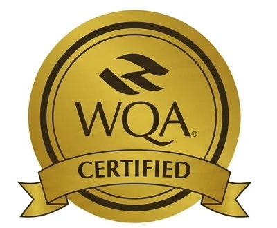

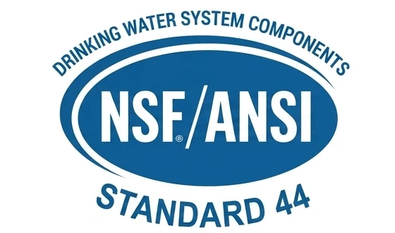

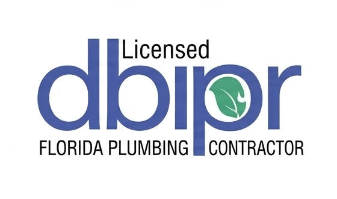

## What Water Softener Services Are Available in Tampa, FL?

Water Softener of Tampa covers six core services, from first installation to long-term maintenance, and adds specialty systems for larger homes, businesses and wells.

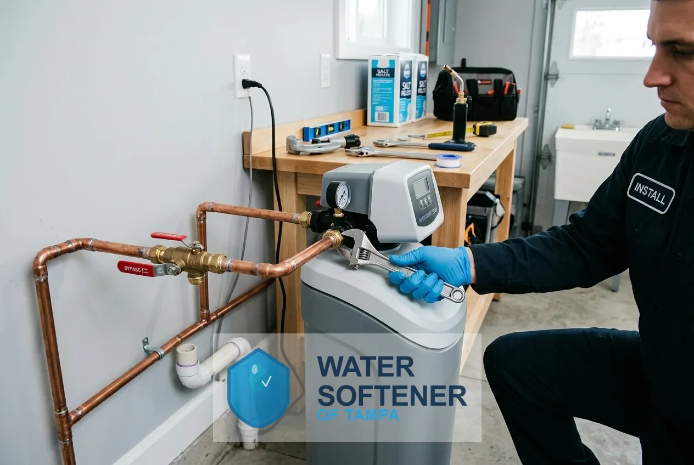

### Water Softener Installation

Installation connects a new softener to your home's main water line so every faucet, shower and appliance receives softened water. The unit is sized to your household and water use, fitted with a bypass valve, connected to a drain and brine line, programmed and tested at every tap before the technician leaves.

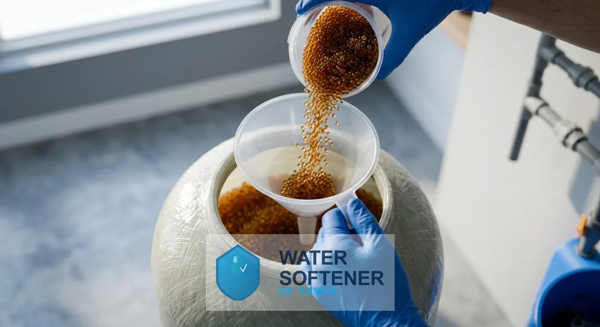

### Water Softener Replacement

Replacement removes an old or failing softener and installs a new, correctly sized unit on the existing plumbing. It covers full system replacement, resin bed replacement and upgrades for systems that no longer soften, leak, or cost more to repair than they are worth.

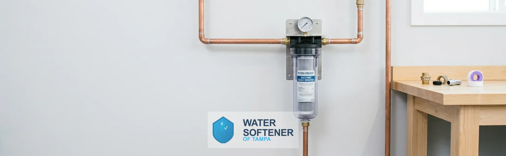

### Salt-Free Water Softener Systems

A salt-free system conditions hard water so scale no longer clings to pipes and fixtures. It does not remove calcium and magnesium, needs no salt and no drain line, and fits homeowners who want lower maintenance over full softening.

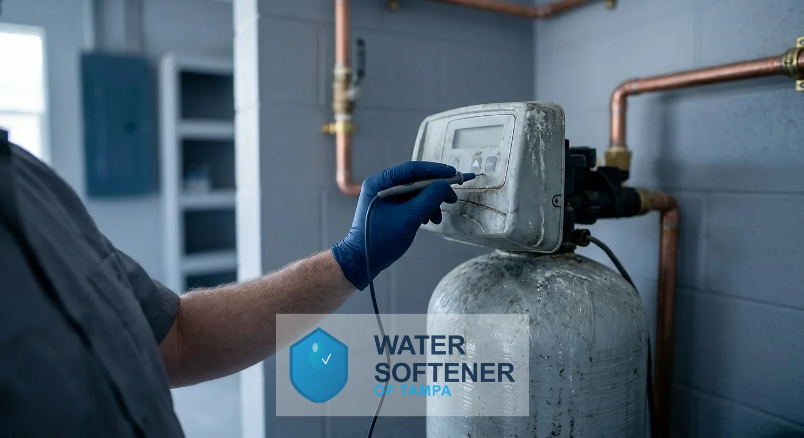

### Water Softener Repair & Service

Repair and service restores softeners that stop regenerating, leave hard water, run out of salt too fast or leak at the control head. Routine service includes resin and brine tank checks, cleaning, salt refills and valve testing.

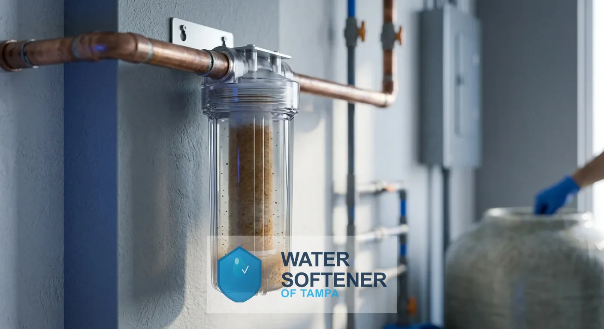

### Whole House Water Filtration

Whole house filtration treats water where it enters the home, reducing chlorine taste and sediment before it reaches every tap. It pairs with a softener because filtration and softening solve different problems.

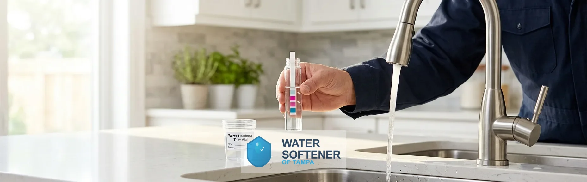

### Water Quality Testing

A water quality test measures hardness, iron, pH, total dissolved solids and other values that decide which system fits. It is the first step of every recommendation.

Dual tank and commercial water softeners, water conditioners, reverse osmosis and UV purification, drinking water systems, well water treatment and contaminant removal filters are also available.

## Why Is Tampa Water So Hard?

Tampa water is hard because the river it comes from carries minerals from limestone groundwater. According to a 2010 U.S. Geological Survey report titled “A Geochemical Mass-Balance Method for Base-Flow Separation, Upper Hillsborough River Watershed, West-Central Florida, 2003-2005 and 2009,” the surface water in the upper Hillsborough River basin is a calcium-bicarbonate type water that closely resembles groundwater, which indicates that much of it comes from local groundwater discharge. The same report found that the discharge is diluted by precipitation and runoff in the wet season but retains the calcium-bicarbonate characteristics of Upper Floridan aquifer water.

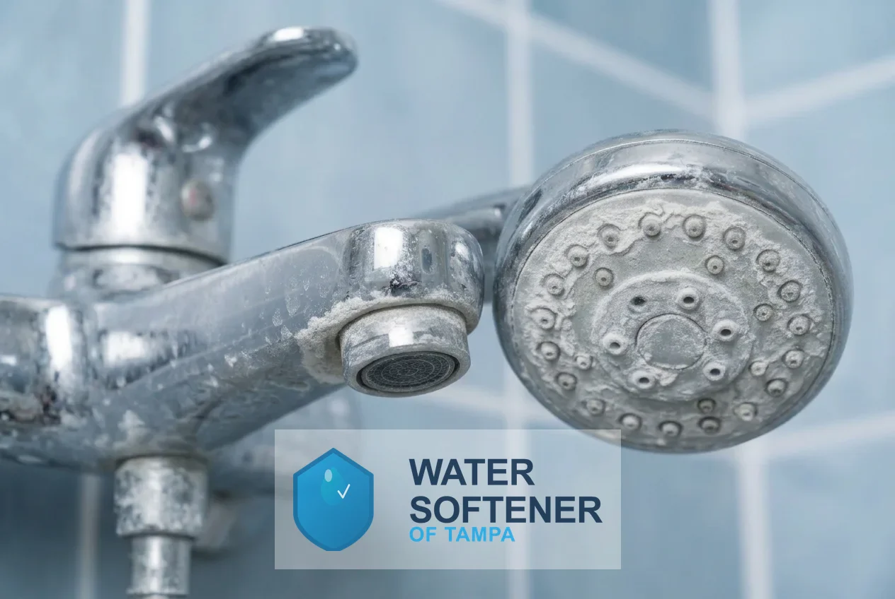

### Where Does Tampa Water Come From?

According to the Tampa Water Department's 2025 water quality report, customers rely on the Hillsborough River as their primary source. The department also used 980 million gallons of treated water stored in its aquifers and recovery wells in 2025 and bought 2.7 percent of Tampa's drinking water from Tampa Bay Water.

### Why Does Limestone Groundwater Make Water Hard?

Water that has passed through limestone carries dissolved calcium and magnesium, and those two minerals define hardness. The USGS describes the upper Hillsborough River's calcium-bicarbonate water as the same type as Upper Floridan aquifer water.

### How Is Water Hardness Measured?

Hardness is measured in milligrams per liter (mg/L) or grains per gallon (gpg), where 1 gpg equals about 17.1 mg/L. The U.S. Geological Survey rates water under 60 mg/L as soft, 61 to 120 mg/L as moderately hard, 121 to 180 mg/L as hard and anything over 180 mg/L as very hard.

### How Hard Is Tampa Water?

The Tampa Water Department's 2025 water quality report put average total hardness at 12.3 grains per gallon, about 211 mg/L, which places it in the very hard range on the U.S. Geological Survey scale, and its 2024 report put the average at 10.8 grains per gallon, about 185 mg/L. The City of Tampa says hardness runs between about 140 and 300 ppm, or 8 to 17 grains per gallon, lower in the wet season and higher in the dry season.

### What Does the Tampa Water Department's Report Show?

The department adds chlorine and then ammonia to create chloramine, and its 2025 report gave a daily average of 3.6 ppm for chlorine and chloramines, under the 4.0 ppm limit, with an average pH of 7.88. Hardness itself is a household problem: scale narrows pipes, coats heating elements and spots glass.

### How Do You Find Your Exact Hardness?

A free water test shows the exact reading at your tap, because the season, the supply blend and home plumbing all move the number.

