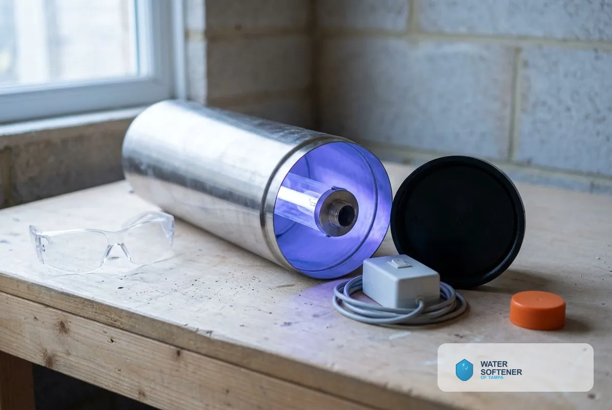
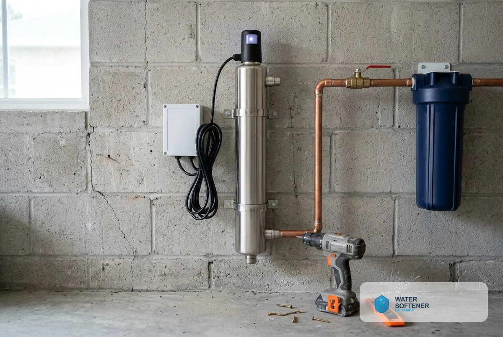
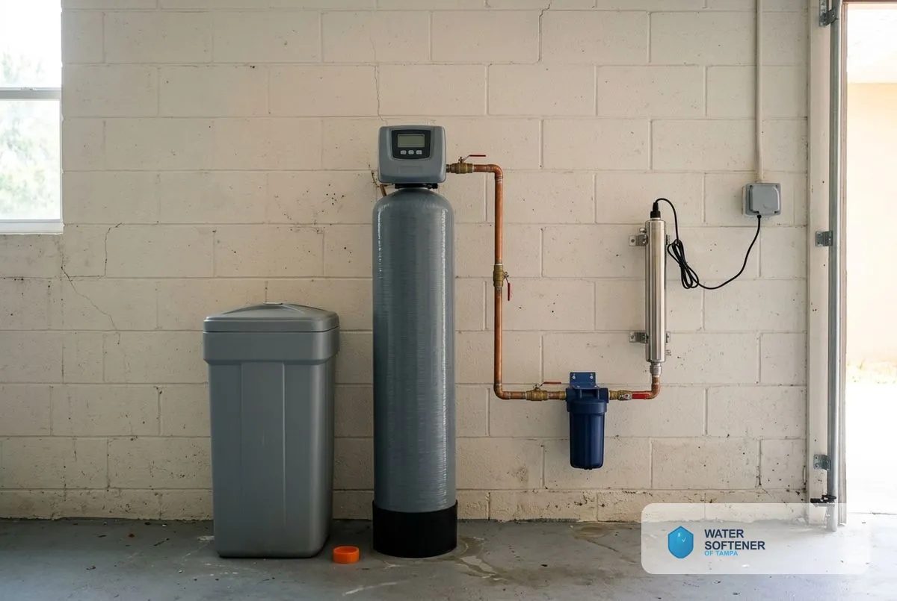

## How Does UV Water Purification Work in Tampa, FL?

UV purification covers three topics: how UV works, UV system installation and combining UV with a water softener.

### How UV Water Purification Works

UV purification passes water through a chamber with an ultraviolet lamp. The light damages the genetic material of bacteria, viruses and cysts, so they cannot reproduce or cause illness. UV adds nothing to the water and does not change its taste. It does not remove minerals, chemicals or sediment, so it works as a disinfection step alongside other treatment.

### UV System Installation

We install the UV unit on the main line after any sediment or carbon filters, so the water entering the chamber is clear. The technician sizes the unit to your flow rate, mounts it, connects power and tests for flow. The lamp needs replacing about once a year, and the quartz sleeve needs occasional cleaning. Replace the lamp every 12 months even if it still glows, because UV output fades before the lamp burns out.

### UV and Water Softener Combination

A UV system disinfects, and a softener removes hardness, so they solve different problems. Hardness scale can coat the quartz sleeve and reduce UV output, so softened water helps the UV unit work better. Many homes that use both place the softener ahead of the UV system. The Tampa Water Department's primary source is the Hillsborough River, and hardness is the common local concern. Its 2025 water quality report put average total hardness at 12.3 grains per gallon, about 211 mg/L, which the U.S. Geological Survey rates as very hard.

### Ideal for Well Water in Tampa

[Private wells](/well-water-softener-tampa-fl/) are not tested or disinfected for you, and well-water guidance recommends that owners test for bacteria at least annually. UV purification is a chemical-free way to protect a household when a test finds bacteria or when you want ongoing protection. Wells with sediment or iron need those problems treated first, since particles shield microbes from the light.

> **Not a good fit if...** your main concern is chemicals, hardness or taste. UV does not address those. A carbon filter, softener or RO does.

## Does your water need disinfection?

If a test finds bacteria, or you rely on a private well, disinfection is worth adding. A test tells you before you spend.

Homeowners comparing options also read about [whole-house water filtration](/water-filtration-systems/), [free water testing](/water-quality-testing/), [drinking water systems](/drinking-water-systems/) and [the hard water guide](/water-softener-guides/hard-water-tampa-fl/).

## Frequently Asked Questions

Does UV remove chemicals or hardness?

No. UV inactivates microbes only. Hardness, chemicals and sediment need other treatment.

How often do I replace the UV lamp?

Lamps commonly need replacing about once a year, even if they still glow, because output fades. Follow your unit's guidance.

Does UV change the taste of water?

No. UV adds no chemicals and leaves taste unchanged.

Do I need a pre-filter with a UV system?

Yes. Cloudy or sediment-heavy water shields microbes from the light, so a sediment filter goes ahead of the UV unit.

[Water Softener of Tampa FL](/) provides UV water purification system installation for homes and businesses across Tampa and Hillsborough County.

## Get Your Free Estimate

Request a free UV water purification estimate. We will contact you to confirm a time. [Get a Free Estimate](#estimate) or return to Water Softener of Tampa for every service we offer.
