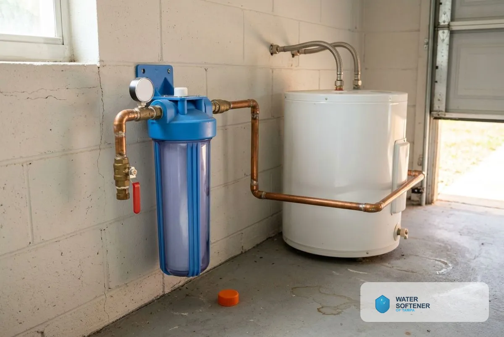
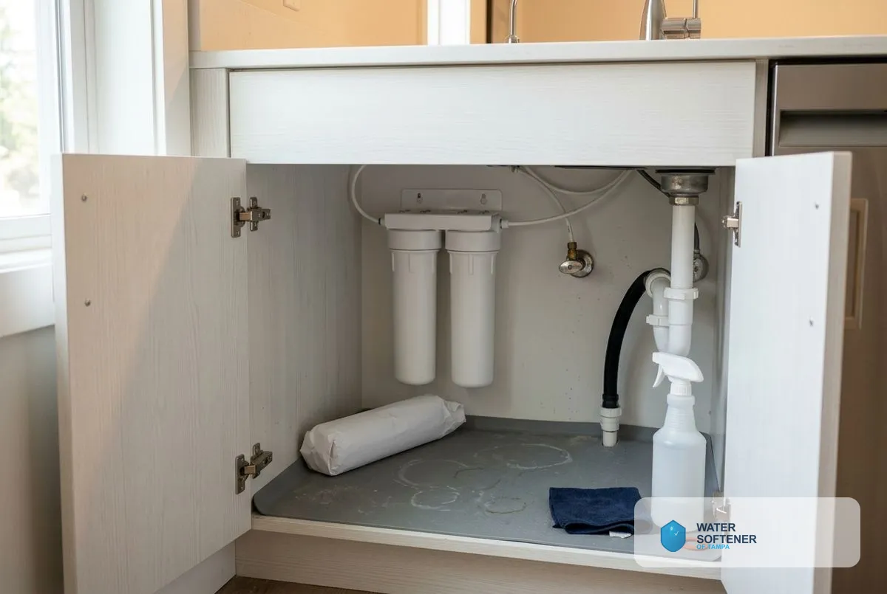
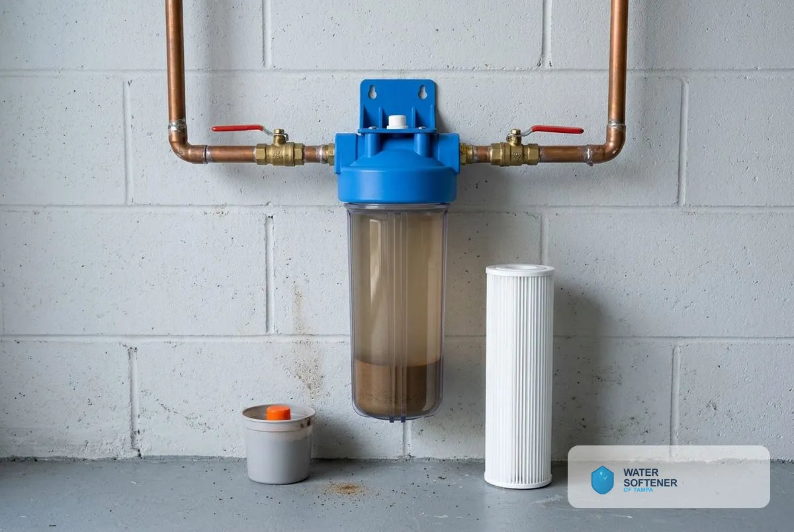
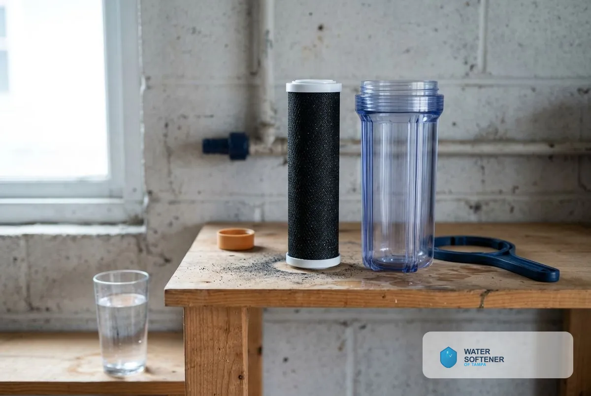
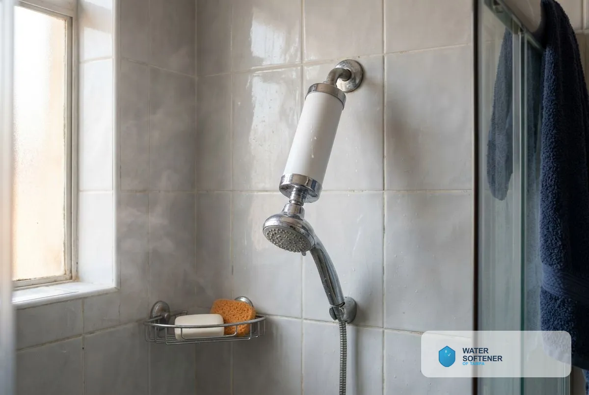
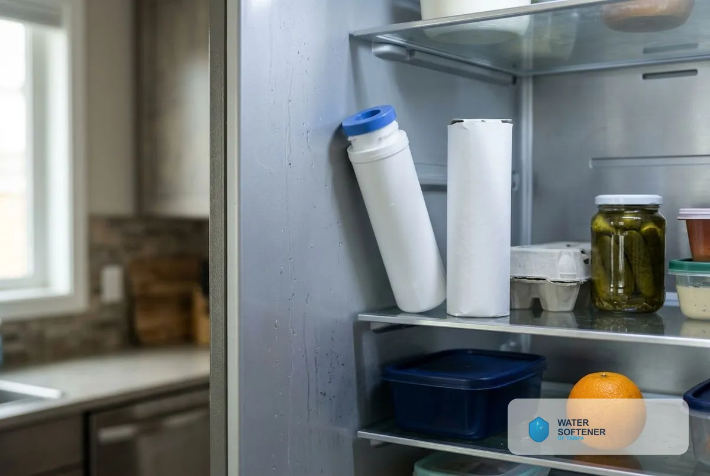
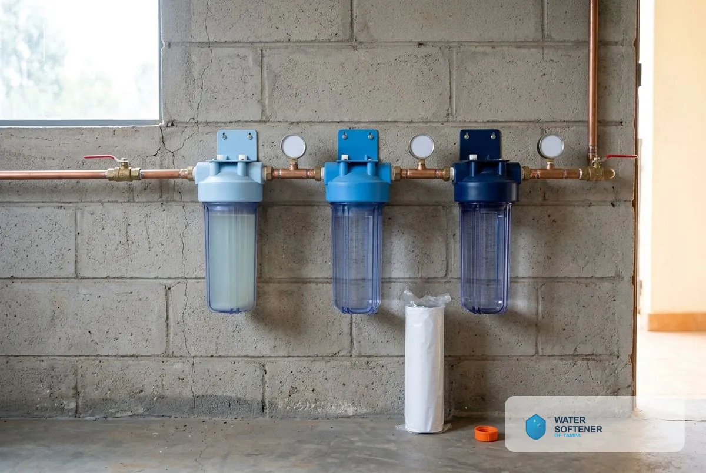

## What Types of Water Filtration Systems Do Tampa Homes Use?

Seven filtration options cover the whole house, the sink, the shower and the refrigerator: whole house filters, under sink filters, sediment filters, carbon block filters, shower filters, refrigerator filter replacement and multi-stage filtration.

### Whole House Water Filter

A whole house water filter treats water at the main line so every tap and appliance gets filtered water. Typical media remove sediment, chlorine, taste and odor. It protects plumbing, appliances and fixtures, and it pairs with a softener because filtration does not remove hardness. A free test shows which media your water needs.

### Under Sink Water Filter

An under sink water filter treats the water at one faucet, usually for drinking and cooking. It installs inside the cabinet with a dedicated faucet or a connection to the existing tap. It gives better-tasting water without treating the whole house.

### Sediment Filter Installation

A sediment filter traps sand, silt and rust particles. Filters are rated in microns, and a lower number catches finer particles. Sediment filtration often comes first in a multi-stage system because it protects the filters behind it. Homes on wells or with older pipes benefit most.

### Carbon Block Filter

A carbon block filter uses compressed activated carbon to reduce chlorine, taste, odor and certain organic compounds. It improves the taste and smell of tap water. Carbon filters need replacement on a schedule because the media fills up. We also handle activated carbon filter replacement. Carbon filter cartridges are typically replaced every 6 to 12 months.

### Shower Filter Installation

A shower filter installs between the pipe and the showerhead to reduce chlorine at the point of use. People with dry skin or sensitive hair often choose it. It does not soften water, so hard-water spotting and soap film remain without a softener.

### Refrigerator Filter Replacement

Refrigerator filters improve taste and clarity of ice and water. Manufacturers commonly recommend replacement about every six months, and the right interval depends on the model. We replace filters and reset the indicator.

### Multi-Stage Filtration

A multi-stage system combines sediment, carbon and specialty media in sequence, each stage protecting the next. It suits homes with several water concerns at once, such as sediment plus chlorine plus odor.

### Backwash Filter Systems

A backwash filter system cleans its own media by reversing flow on a schedule, which flushes captured particles to the drain. It lasts longer between media changes than a cartridge filter, and it suits whole-house use with higher flow.

> **Not a good fit if...** your main concern is hard water. Filters do not soften. Hardness needs a softener or conditioner: the Tampa Water Department's 2025 water quality report put average total hardness at 12.3 grains per gallon, about 211 mg/L.

## Does filtration replace a water softener?

No. Filters remove particles and some chemicals, and softeners remove hardness minerals. Many Tampa homes need both. See our [Water Treatment Services in Tampa, FL](/water-treatment-and-testing/) for how they fit together.

Homeowners comparing options also read about [reverse osmosis systems](/reverse-osmosis-installation/), [drinking water systems](/drinking-water-systems/), [UV water purification](/uv-water-purification/), [water contaminant removal](/water-contaminant-removal-tampa-fl/) and [free water testing](/water-quality-testing/).

## Frequently Asked Questions

How often does a water filter need replacing?

Replacement depends on the filter type and your water. Sediment and carbon cartridges commonly need changing every few months to a year. Whole-house pre-filter cartridges are typically replaced every 6 to 12 months.

Will a whole house filter lower my water pressure?

A correctly sized filter keeps pressure steady. A clogged or undersized one reduces it, so we size to your flow.

Do I need a filter if I have a water softener?

Often yes. A softener removes hardness, and a filter removes sediment and chlorine that can also damage resin.

What does a shower filter remove?

It reduces chlorine. It does not remove hardness minerals.

What does filter installation cost in Tampa?

Our estimate is free and itemized.

[Water Softener of Tampa FL](/) provides water filtration system installation for homes and businesses across Tampa and Hillsborough County.

## Get Your Free Estimate

Request a free water filtration estimate. We will contact you to confirm a time. [Get a Free Estimate](#estimate) or return to Water Softener of Tampa for every service we offer.
