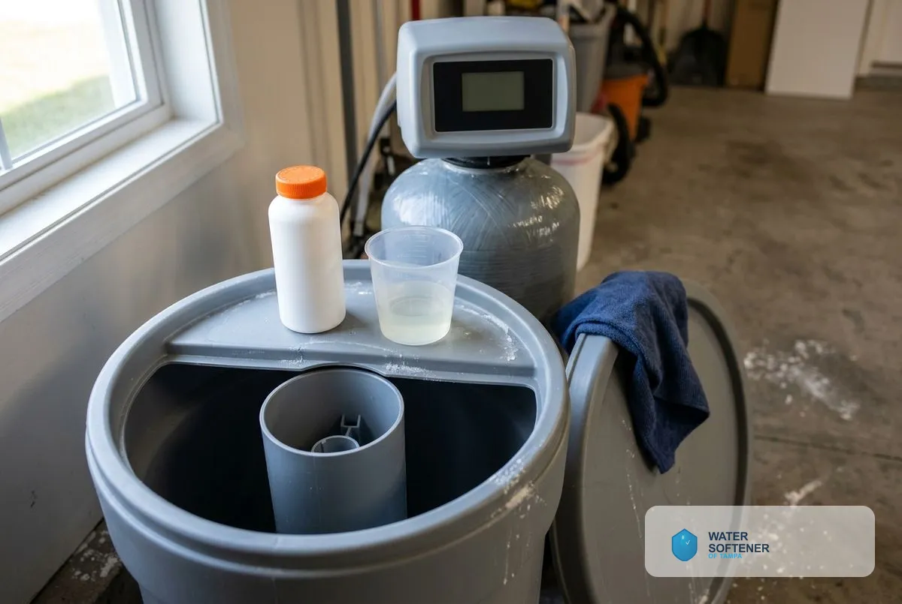
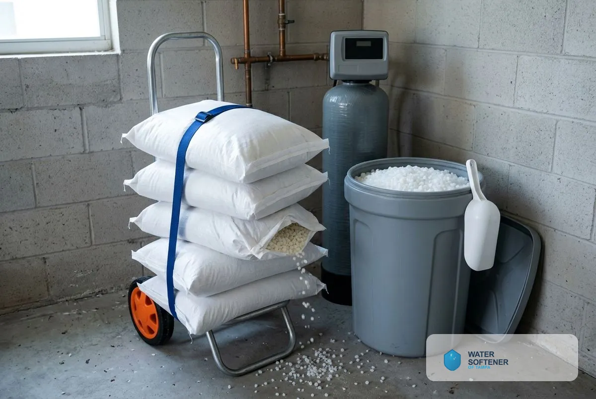
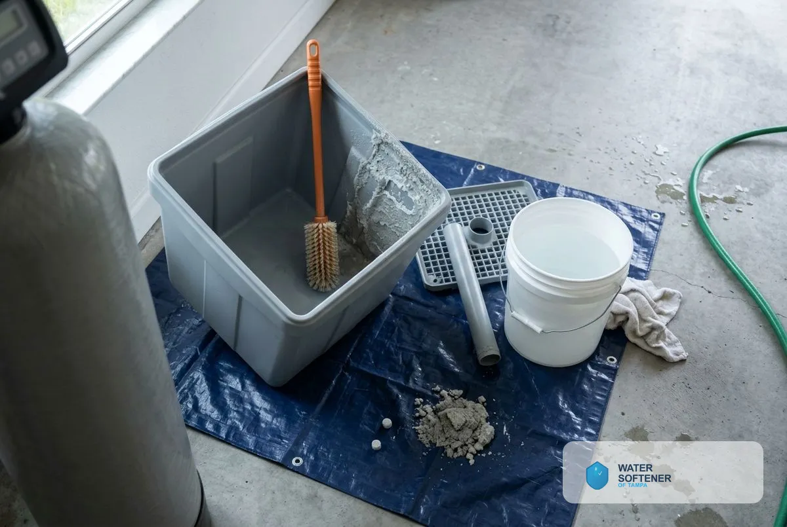
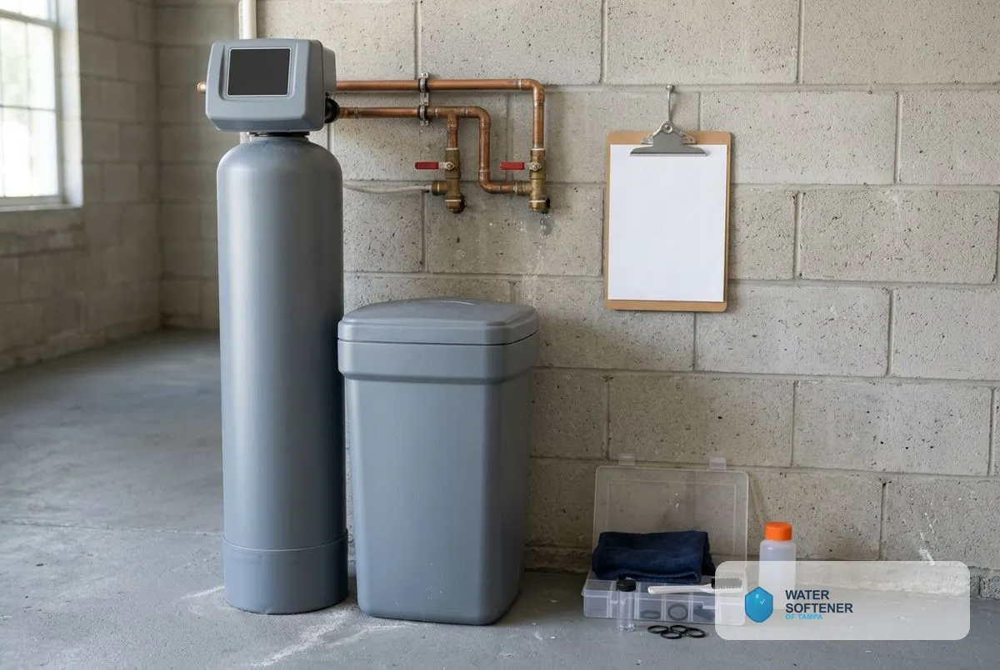

## What Does Water Softener Maintenance Include in Tampa, FL?

Four services keep a softener at full capacity: resin cleaning, salt refills, brine tank cleaning and annual maintenance plans.

### Water Softener Resin Cleaning Service

Resin cleaning removes iron, sediment and mineral film from the resin beads that do the softening. Fouled resin loses capacity, so water turns hard sooner after each cycle. We flush the resin bed with a resin cleaner and test your softened water afterward. Homes on private wells or with iron in the water benefit most. A routine service visit typically takes 60 to 90 minutes.

### Water Softener Salt Refill Service

A salt refill service keeps the brine tank stocked so the softener can regenerate. Keep the salt level above about one-third full, and check it monthly. We deliver and load salt that suits your unit, whether block, pellet or crystal, or potassium chloride for households that avoid sodium. Ask whether the installer delivers salt, and compare that with buying 40-pound bags yourself.

### Water Softener Brine Tank Cleaning

The brine tank collects sludge from impurities in salt over time, and sludge can clog the injector and block the brine line. We empty the tank, remove sludge and salt crust, rinse it and refill with fresh salt. Plan this about once a year, or sooner if you see a salt bridge or a thick, wet layer at the bottom.

### Annual Maintenance Plans

An annual maintenance plan covers a scheduled inspection of the resin, control valve, injector, brine system and settings, along with cleaning. Regular service extends the life of the unit and spots small problems before they become repairs. A yearly service visit typically includes sanitization, a valve check and a tune-up, and a salt delivery is a separate item. Ask what a plan includes and how many visits it covers each year.

### How Often Does a Softener Need Service in Tampa?

Service a softener once a year, check salt monthly and clean the brine tank annually. Heavier hardness or iron in the water shortens those intervals. Tampa water comes mostly from the Hillsborough River, and the hardness minerals in it load the resin every day. The Tampa Water Department's 2025 water quality report put average total hardness at 12.3 grains per gallon, about 211 mg/L, which the U.S. Geological Survey rates as very hard.

> **Not a good fit if...** your unit leaks, never regenerates or shows repeated error codes. That is a repair job, not maintenance.

## Can you maintain your softener yourself?

Adding salt and checking the control head are simple homeowner tasks. Resin cleaning, injector checks and valve inspection are easier and safer with a technician. A free visit shows what your system needs.

Homeowners comparing options also read about [water softener repair](/water-softener-repair/), [water softener replacement](/water-softener-replacement/), [how long a water softener lasts](/water-softener-guides/how-long-do-water-softeners-last/), [salt-based and salt-free softeners compared](/water-softener-guides/salt-vs-salt-free-water-softener/) and [free water testing](/water-quality-testing/).

## Frequently Asked Questions

How much salt does a water softener use?

Salt use depends on hardness and water use. Check the brine tank monthly and refill when the level drops near one-third full.

Which type of salt suits my softener?

Block, pellet or crystal salt all work, and your manual names the right one. Potassium chloride suits households that avoid sodium.

What is a salt bridge?

A salt bridge is a hard crust that forms above the water in the brine tank, so salt cannot dissolve into brine. We break it up and clean the tank.

Why does my water feel hard right after a refill?

Salt alone does not soften water. The unit must complete a regeneration cycle, and hard water after that points to resin, injector or valve trouble.

Do you service softeners you did not install?

Many brands can be serviced. Tell us the make and model when you request service and we will confirm whether we can work on it.

[Water Softener of Tampa FL](/) provides water softener maintenance for homes and businesses across Tampa and Hillsborough County.

## Get Your Free Estimate

Request a free water softener service estimate. We will contact you to confirm a time. [Get a Free Estimate](#estimate) or return to Water Softener of Tampa for every service we offer.
