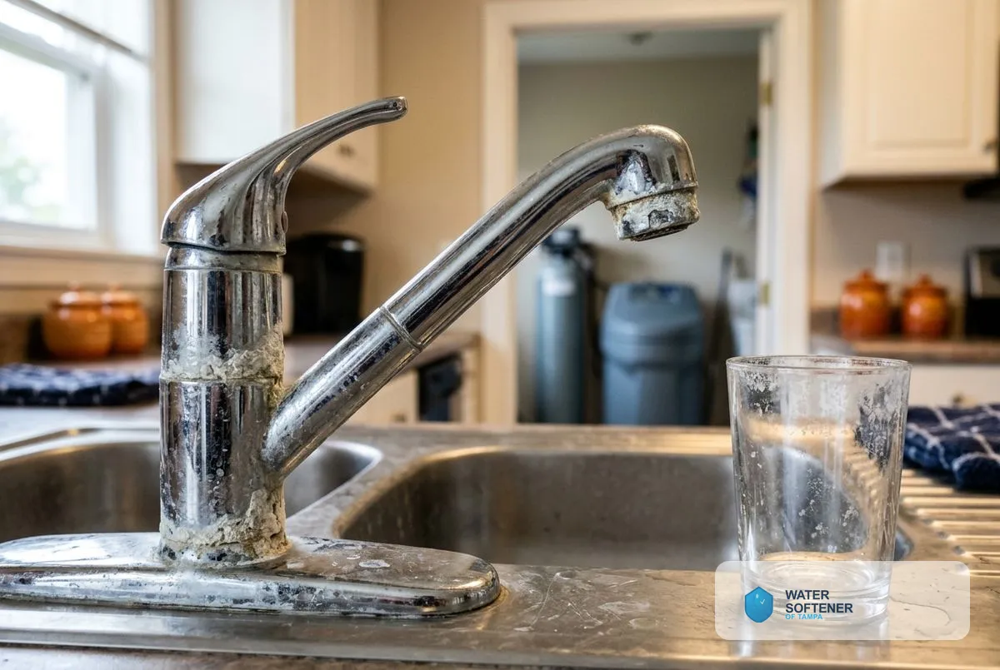
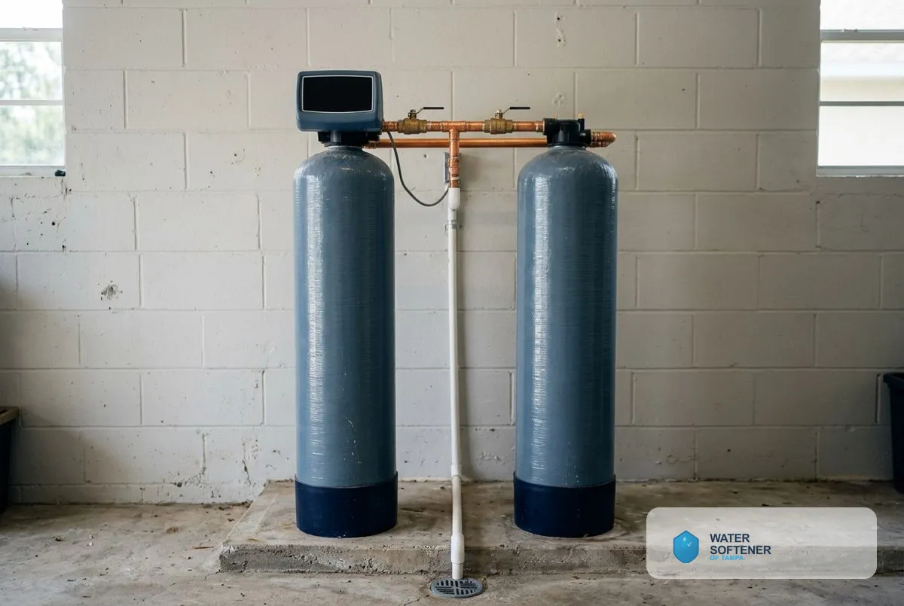
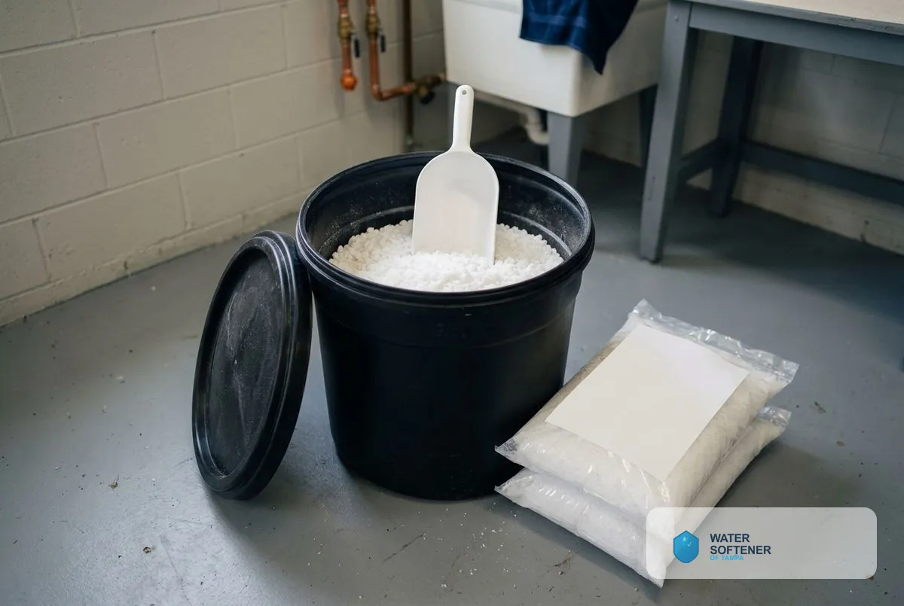
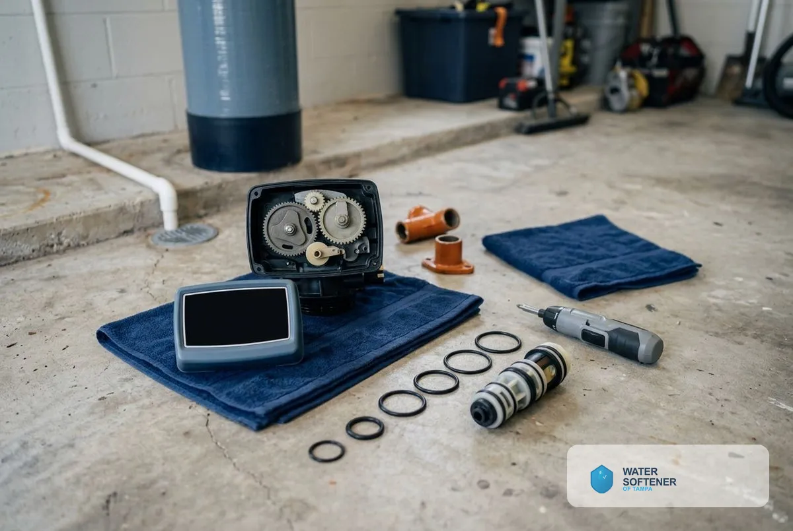
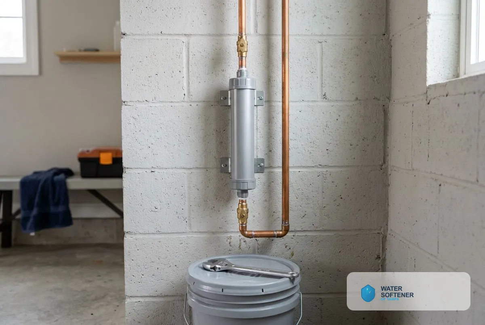

## What Types of Water Softener Systems Are Available in Tampa, FL?

This page covers installation, replacement, salt-free systems, dual tank systems, commercial systems, maintenance, repair and water conditioners, starting with why Tampa water needs a softener.

### Why Tampa Water Needs a Water Softener System

Tampa water tests as very hard, and a softening system treats it where it enters the home so every tap benefits. The Tampa Water Department reports that the Hillsborough River is its primary source, and its 2025 report gave an average total hardness of 211 mg/L, or 12.3 grains per gallon. The Water Quality Association classes anything over 10.5 grains per gallon as very hard, so the 12.3 average sits above that line, and the City of Tampa says hardness runs between about 8 and 17 grains per gallon through the year.

### Water Softener Installation

[Water Softener Installation in Tampa, FL](/water-softener-installation/) connects a whole-house unit to your main water line, with a bypass valve, a drain line and a tested result at every tap. It is the starting point for most Tampa homeowners.

### Water Softener Replacement

[Water Softener Replacement in Tampa, FL](/water-softener-replacement/) removes a failing or undersized unit and installs a correctly sized new one, including resin bed and upgrade options.

### Salt-Free Water Softener Systems

[Salt-Free Water Softener Systems in Tampa, FL](/salt-free-water-softener-systems/) condition the water so scale does not stick. They need no salt and no drain line, and they leave the minerals in the water, so they reduce scale rather than remove hardness.

### Dual Tank Water Softener Installation

[Dual Tank Water Softener Installation in Tampa, FL](/dual-tank-water-softener/) uses two tanks, so one serves the house while the other regenerates. Soft water never pauses, which suits large households and heavy water use.

### Commercial Water Softener Installation

[Commercial Water Softener Installation in Tampa, FL](/commercial-water-softener/) protects restaurants, laundries, car washes, hotels and other businesses where scale damages equipment and raises operating cost.

### Water Softener Maintenance

[Water Softener Maintenance in Tampa, FL](/water-softener-maintenance/) keeps a unit at full capacity with resin and brine tank checks, cleaning, salt refills and valve testing.

### Water Softener Repair

[Water Softener Repair in Tampa, FL](/water-softener-repair/) restores softeners that stop regenerating, leave hard water, use too much salt or leak at the control head.

### Water Conditioner Installation

[Water Conditioner Installation in Tampa, FL](/water-conditioner-installation/) adds a scale-control system to the main line for homes that want protection without salt or a drain.

### How to Choose a Water Softener System

If your water tests above 10.5 grains per gallon and you want the hardness minerals removed, a salt-based softener is the system that does it. If scale control matters more than full softening, or salt and a drain line are a problem, a salt-free system reduces scale instead.

| System | What it does | Needs salt | Needs a drain | Best for |
|---|---|---|---|---|
| Salt-based softener | Removes calcium and magnesium by ion exchange | Yes | Yes | Hardness above 10.5 gpg, soft-water feel for skin and laundry |
| Dual tank softener | Two tanks alternate, so soft water never pauses | Yes | Yes | Large households, heavy water use, businesses |
| Salt-free conditioner | Changes how scale forms so it does not stick | No | No | Low maintenance, scale protection |

A household of four using 320 gallons a day at 12.3 grains per gallon removes about 3,900 grains daily, so a 32,000-grain unit regenerates about every 8 days. A free hardness test at your tap replaces that example with your own number.

> **Not a good fit if...** you are on a private well with iron or sulfur. Those need filtration before a softener, and a test shows which. See [Water Treatment Services in Tampa, FL](/water-treatment-and-testing/) for well and filtration options.

### Get Your Free Estimate

Request a free estimate or call to choose the system that fits your home. The estimate is itemized, so you see the unit, the plumbing work and the labor before you approve anything.

## What Decides Which Water Softener System Fits a Tampa Home?

Four things decide the system: your water's hardness, your household's daily use, your install space and whether you want salt in the picture. A hardness test and a look at the install spot answer the first and third, and the other two are your call.

## Frequently Asked Questions About Water Softener Systems

What is the best water softener system for Tampa homes?

The best system matches your household size and your test result. A salt-based softener removes hardness minerals and suits readings above 10.5 grains per gallon, and a dual tank unit suits large households that cannot wait through a regeneration.

Can I install a water softener myself in Florida?

Many homeowners install their own softener, but licensing and permit rules for water treatment and plumbing work are set by the state and the county or city, so check the Florida requirements for your job before you start. Anyone who installs a softener for a fee should hold the licence the state requires, so ask for the licence number and proof of insurance before the work starts.

What is the difference between a water softener and a water conditioner?

A softener removes calcium and magnesium through ion exchange, and a conditioner changes how those minerals behave so scale does not stick. The softener lowers the hardness number, and the conditioner leaves it where it is.

Does a water softener use electricity?

A softener with an electronic control head uses a small amount of power to run its regeneration schedule, and it needs a nearby outlet. A salt-free conditioner needs no power.

[Water Softener of Tampa FL](/) provides water softener systems for homes and businesses across Tampa and Hillsborough County.

